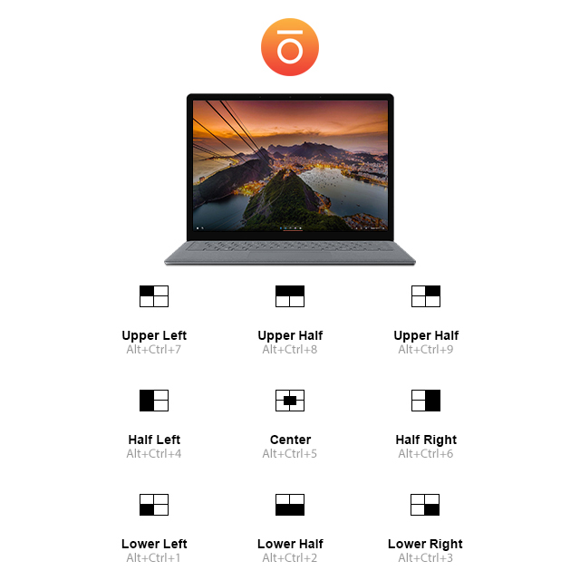

<p align="center">
  <br><br>
</p>

# Sōkan (壮観)

Easily organize windows without using a mouse.

---

#### Table of Contents:
* [Download](#download)
* [Support this project](#support-this-project)
* [How to setup](#how-to-setup)
* [Development](#development)
* [Task Scheduler](#task-scheduler)
* [Question](#question)

---

## Download

You can download the application on the release page.<br />
https://github.com/genesisneo/sokan/releases

---

## Support this project

If you rely on this tool and find it useful, please consider supporting it.<br />
Maintaining an open-source project takes time and a cup of coffee would be greatly appreciated!

<a href="https://www.buymeacoffee.com/genesisneo" target="_blank">
  
</a>

---

## How to setup

* Please note that this application only works on **_Windows_** operating system
* Download, Fork, or Clone this repo
* Download and install [Node.js ^20.12.2](https://nodejs.org/en/download/releases/).<br />
If you need multiple versions, you can use [nvm-windows](https://github.com/coreybutler/nvm-windows)
* Install the latest **_Python_** from [Microsoft App Store](https://apps.microsoft.com/search/publisher?name=Python+Software+Foundation).<br />
I use [Python 3.12](https://www.microsoft.com/store/productId/9NCVDN91XZQP?ocid=pdpshare) when developing this project
* Install **_Visual Studio 2019_** or later.<br />
Use the `Desktop development with C++` workload from [Visual Studio Community](https://visualstudio.microsoft.com/thank-you-downloading-visual-studio/?sku=Community)
* Open your preferred **_shell_** as Administrator and execute this command
```
Set-ExecutionPolicy RemoteSigned
```
* Install `node-gyp` globally
```
npm i node-gyp -g
```
* Navigate back to this repo and install all the dependencies
```
npm i
```
* You can now do the following:
```
# start application
npn run start

# clean the application
npm run clean

# package the application
npm run package

# build the portable
npm run build
```

---

## Development

To show developer tool and excute console log.<br />
You can add the following code after `window.loadFile`.

```
window.webContents.openDevTools();
window.webContents.executeJavaScript(`console.log(">>> ${process.execPath}")`);
```

---

## Task Scheduler

Since the application is not signed, it will not run on Windows start, even if the application is added on the following:

```
# registry editor
Computer\HKEY_CURRENT_USER\SOFTWARE\Microsoft\Windows\CurrentVersion\Run
# windows startup
%APPDATA%\Microsoft\Windows\Start Menu\Programs\Startup
```

To run the application on Windows start, we can use Task Scheduler. The `scheduler.bat` file, will create a basic task when **_Run as administrator_**.

Please note that before running this file as administrator, edit the file using Notepad or your preferred text editor and update the `"C:\PATH\TO\Sokan.exe"` accordingly. See example below.

```
SCHTASKS /CREATE /SC ONSTART /TN "Sokan" /TR "C:\Program Files\Customization\Sokan.exe" /RL HIGHEST
```

---

## Question

If you have question, you can always contact me on Twitter [@genesis_neo](https://twitter.com/genesis_neo) and of course here in GitHub [@genesisneo](https://github.com/genesisneo). Thank you.

---

<p align="center">-=[ :heart: ]=-</p>